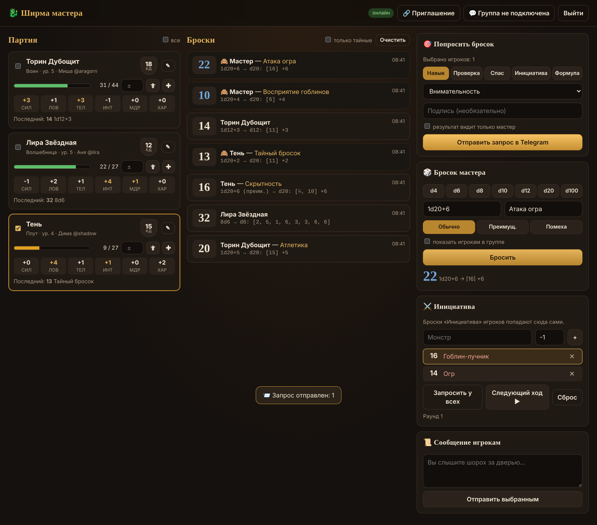
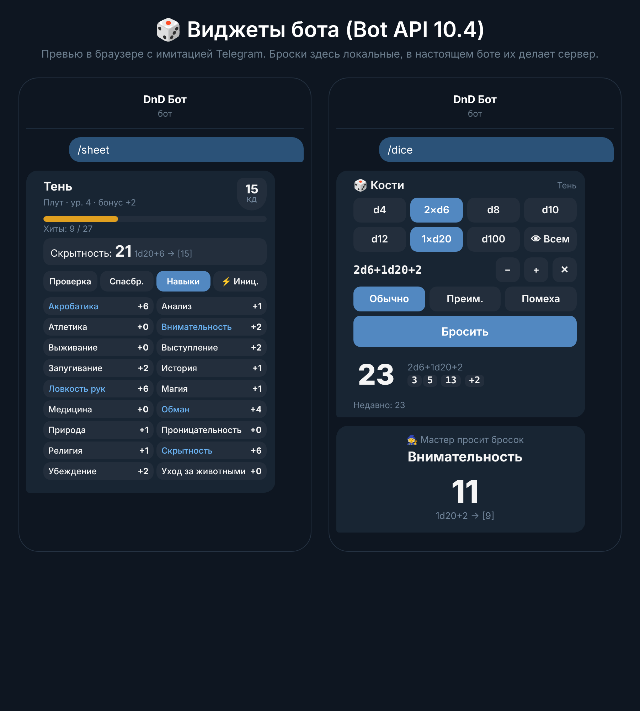

# 🐉 DnD: ширма мастера + бот для бросков

Мини-набор для игры с друзьями:

- **Сайт мастера** («ширма»): живая лента бросков всех игроков, карточки персонажей с хитами, запросы бросков, тайные броски, трекер инициативы, сообщения игрокам.
- **Telegram-бот** для игроков на **HTML-виджетах из Bot API 10.4**: кости, лист персонажа и «мастер просит бросок» прямо в сообщении. Броски делает сервер, так что подкрутить их нельзя 😉

Всё работает в одном Docker-контейнере. Данные хранятся в SQLite в папке `data/`.

## Как это выглядит

| Сайт мастера | Виджеты в Telegram |
|---|---|
|  |  |

Превью виджетов без Telegram можно открыть на своём сервере: `http://<сервер>:8080/demo`.

## Установка на VPS (≈5 минут)

1. **Создай бота.** Напиши [@BotFather](https://t.me/BotFather) → `/newbot` → придумай имя → скопируй токен вида `123456:ABC…`.
2. **Зайди на VPS** (Ubuntu/Debian) и скачай проект:
   ```bash
   git clone https://github.com/s1bbb/dnd.git && cd dnd
   ```
3. **Запусти установщик:**
   ```bash
   bash setup.sh
   ```
   Он поставит Docker, если его нет, спросит токен, пароль мастера и домен (домен можно пропустить), а потом всё запустит.
4. Открой адрес, который он напишет (например `http://1.2.3.4:8080`), и войди с паролем мастера.

> С доменом (A-запись домена указывает на IP сервера) сайт сам получит HTTPS-сертификат через Caddy.
> Без домена сайт работает по `http://IP:8080`. Если не открывается, проверь, что порт 8080 открыт в файрволе (`ufw allow 8080`).

## Как играть

1. На сайте мастера нажми **🔗 Приглашение**: ссылка скопируется. Отправь её друзьям.
2. Друг открывает ссылку, жмёт «Start» и получает от бота **лист персонажа** и **кости**. На сайте он сразу появляется в «Партии».
3. Игроки заполняют персонажа командами (или мастер заполняет всё на сайте через ✎):
   ```
   /name Торин
   /class Воин 5
   /stats 17 12 16 9 11 10     ← СИЛ ЛОВ ТЕЛ ИНТ МДР ХАР
   /hp 44 44
   /ac 18
   ```
   Владения навыками и спасбросками мастер отмечает галочками в редакторе на сайте.
4. **Общий чат (по желанию):** добавь бота в групповой чат партии и отправь туда команду `/bindgroup КОД` (точную команду покажет кнопка 💬 на сайте). Тогда все открытые броски будут дублироваться в группу.

### Что умеет игрок (в личке с ботом)

| | |
|---|---|
| `/dice` | виджет костей: d4–d100, модификатор, преимущество/помеха, режим 🙈 «тайно» (бросок увидит только мастер) |
| `/sheet` | лист персонажа: хиты, КД, тап по характеристике — проверка или спасбросок, навыки, инициатива |
| `/roll 2d6+3` или просто `d20+5` | бросок текстом, если в приложении ещё нет виджетов |

Формулы: `1d20+5`, `2d6+1d4-1`, `4d6kh3` (оставить 3 лучших), `2d20kl1`, `d%`. Русские `к20` и `д20` тоже понимает.

### Что умеет мастер (на сайте)

- **Лента бросков** в реальном времени. Криты подсвечены 💥, провалы 💀, тайные броски помечены 🙈.
- **Партия:** хиты с кнопками урона 🗡 и лечения ✚. Лист в Telegram у игрока обновляется сам.
- **Попросить бросок:** навык, проверка, спасбросок, инициатива или любая формула. Отправляется выбранным игрокам (галочки) или всем. Игрок получает виджет с одной кнопкой «Бросить», модификаторы бот считает сам. Можно сделать так, чтобы результат видел только мастер.
- **Бросок мастера:** по умолчанию тайный, можно показать в группе.
- **Инициатива:** «Запросить у всех», затем добавь монстров. Список сортируется сам, кнопка «Следующий ход» листает очередь.
- **Сообщение игрокам:** «Вы слышите шорох за дверью…» уходит выбранным игрокам в личку.

## Важно про виджеты

- Виджеты появились в Bot API 10.4 (9 ноября 2026). Нужна **свежая версия Telegram**: обнови приложение, если вместо виджета видно «не поддерживается». Текстовые `/roll` работают везде.
- Сейчас Telegram разрешает слать виджеты **только в личные чаты с ботом**, поэтому кости и лист живут в личке у каждого игрока, а в группу бот пишет обычные сообщения.

## Обслуживание

```bash
docker compose logs -f dnd                    # логи
docker compose restart dnd                    # перезапуск
git pull && docker compose up -d --build      # обновление
cp data/dnd.sqlite3 ~/backup-$(date +%F).db   # бэкап
```

Посмотреть локально без бота и токена, на тестовых данных:
```bash
pip install -r requirements.txt
DEMO=1 GM_PASSWORD=test python -m app.main   # → http://localhost:8080, пароль test
```

## Устройство

```
app/
  main.py      запуск: сайт + бот (long polling, вебхук и домен не нужны)
  game.py      логика: команды, запросы виджетов, броски, рассылка
  tg.py        мини-клиент Bot API: sendWidget, answerWidgetQuery, editMessageWidgetData
  dice.py      парсер и броски (secrets, честный рандом)
  rules.py     характеристики и навыки D&D 5e
  web.py       сайт мастера: REST + WebSocket
  widgets/     HTML-виджеты (лимит Telegram: 4 КБ в сжатом виде, проверяется тестом)
  static/      страницы сайта мастера и /demo
tests/         pytest
```
