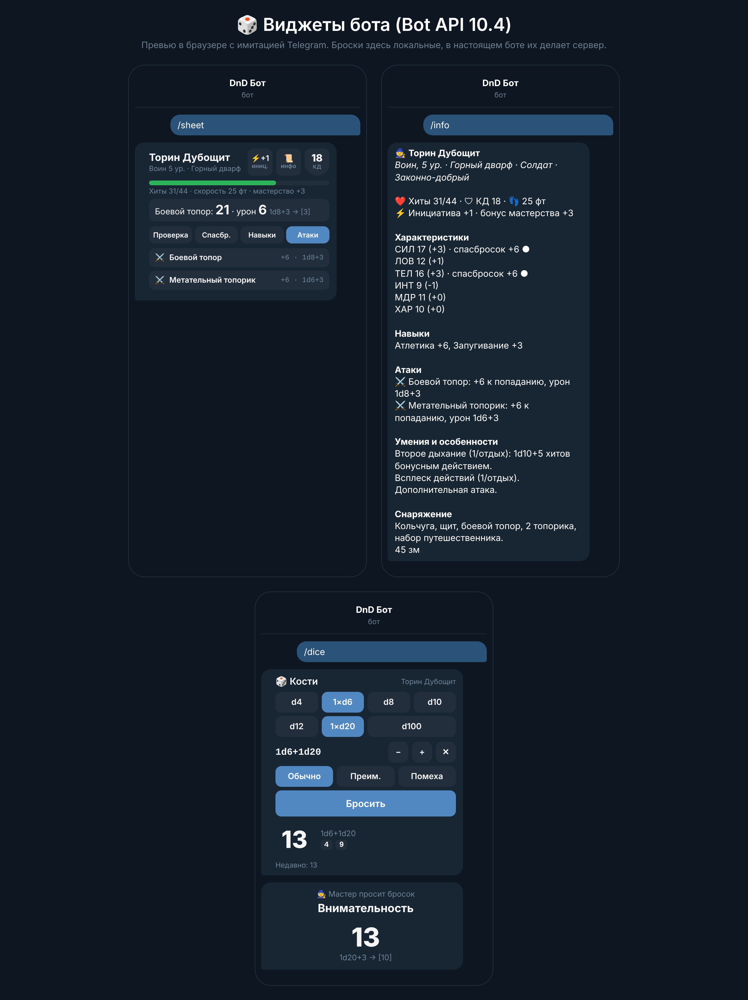
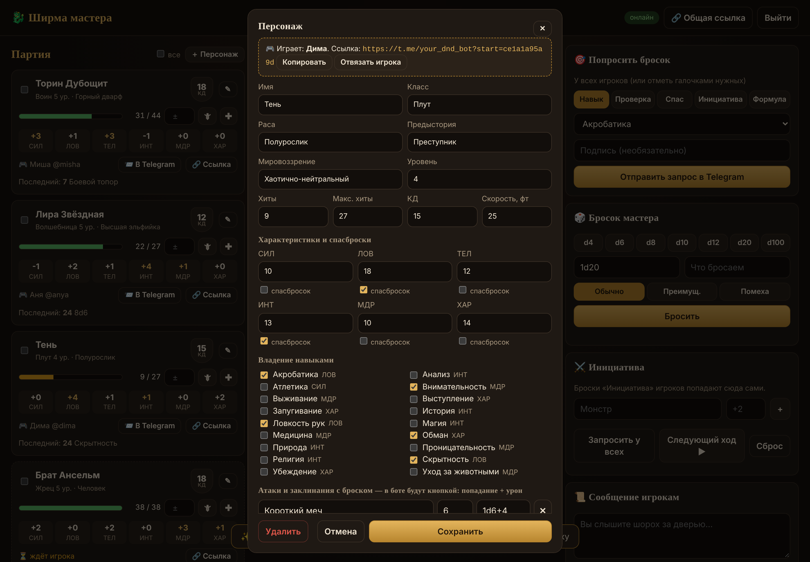

# 🐉 DnD: ширма мастера + бот для бросков

Мини-набор для игры вживую за одним столом:

- **Сайт мастера** («ширма»): создаёшь персонажей в редакторе, видишь все броски игроков в реальном времени, следишь за хитами, просишь бросить проверку, ведёшь инициативу.
- **Telegram-бот** у каждого игрока в личке, на **HTML-виджетах из Bot API 10.4**: лист персонажа с кнопками бросков (проверки, спасброски, навыки, атаки с уроном), кости и полная карточка персонажа. Броски делает сервер, подкрутить их нельзя 😉

Всё работает в одном Docker-контейнере, данные хранятся в SQLite в папке `data/`.

## Как это выглядит

| Сайт мастера | Бот у игрока |
|---|---|
|  |  |

Редактор персонажа:



Превью виджетов без Telegram можно открыть в демо-режиме (см. ниже) по адресу `/demo`.

## Установка на VPS (≈5 минут)

1. **Создай бота.** Напиши [@BotFather](https://t.me/BotFather) → `/newbot` → придумай имя → скопируй токен вида `123456:ABC…`.
2. **Зайди на VPS** (Ubuntu/Debian) и скачай проект:
   ```bash
   git clone https://github.com/s1bbb/dnd.git && cd dnd
   ```
3. **Запусти установщик:**
   ```bash
   bash setup.sh
   ```
   Он поставит Docker, если его нет, спросит токен, пароль мастера и домен (домен можно пропустить), а потом всё запустит.
4. Открой адрес, который он напишет (например `http://1.2.3.4:8080`), и войди с паролем мастера.

> С доменом (A-запись домена указывает на IP сервера) сайт сам получит HTTPS-сертификат через Caddy.
> Без домена сайт работает по `http://IP:8080`. Если не открывается, проверь, что порт 8080 открыт в файрволе (`ufw allow 8080`).

## Как играть

1. **Мастер создаёт персонажей.** На сайте нажми **＋ Персонаж** и заполни лист: класс, раса, характеристики, владения, атаки (название, бонус к попаданию, урон), умения, заклинания, снаряжение, заметки. После «Сохранить» скопируется **личная ссылка** на этого персонажа.
2. **Отправь ссылку игроку.** Он открывает её и жмёт «Start». Бот присылает карточку персонажа, лист с кнопками бросков и кости. На сайте у персонажа вместо «⏳ ждёт игрока» появится имя игрока.
3. **Дальше правь на сайте.** Любое изменение (хиты, новая атака, уровень) само обновится в листе игрока в Telegram. Кнопка **📨 В Telegram** пришлёт карточку и лист заново.

> Игрок может открыть и **общую ссылку** (кнопка 🔗 сверху): тогда у него появится пустой персонаж, которого заполнит мастер.
> Если игрок откроет ссылку другого персонажа, он пересядет на него, а прежний персонаж останется у мастера без игрока.

### Что видит игрок (в личке с ботом)

| | |
|---|---|
| `/sheet` | лист персонажа: хиты, КД, скорость. Вкладки «Проверка», «Спасбр.», «Навыки», «Атаки»: тап по кнопке бросает. Атака бросает сразу попадание и урон, на крите кубики урона удваиваются. ⚡ — инициатива, 📜 — карточка |
| `/info` | карточка персонажа сообщением: всё о персонаже, включая умения, заклинания, снаряжение, заметки |
| `/dice` | кости: d4–d100, модификатор, преимущество или помеха |
| `/roll 2d6+3` или просто `d20+5` | бросок текстом, если в приложении ещё нет виджетов |

Формулы: `1d20+5`, `2d6+1d4-1`, `4d6kh3` (оставить 3 лучших), `2d20kl1`, `d%`. Русские `к20` и `д20` тоже понимает.

### Что умеет мастер (на сайте)

- **Лента бросков** в реальном времени: криты 💥, провалы 💀, у атак сразу виден урон.
- **Партия:** хиты с кнопками урона 🗡 и лечения ✚, модификаторы, последний бросок, редактор ✎ и личная ссылка 🔗.
- **Попросить бросок:** навык, проверка, спасбросок, инициатива или любая формула. Уходит выбранным персонажам (галочки) или всем. Игрок получает виджет с кнопкой «Бросить», модификаторы бот считает сам.
- **Бросок мастера** для себя, его видишь только ты.
- **Инициатива:** «Запросить у всех», затем добавь монстров. Список сортируется сам, кнопка «Следующий ход» листает очередь.
- **Сообщение игрокам:** «Вы слышите шорох за дверью…» уходит в личку выбранным игрокам.

## Важно про виджеты

- Виджеты появились в Bot API 10.4 (9 ноября 2026). Нужна **свежая версия Telegram**: обнови приложение, если вместо виджета видно «не поддерживается». Текстовые `/roll` работают везде.
- Сейчас Telegram разрешает виджеты **только в личных чатах с ботом**, поэтому каждый игрок пользуется ботом у себя в личке.

## Обслуживание

```bash
docker compose logs -f dnd                    # логи
docker compose restart dnd                    # перезапуск
git pull && docker compose up -d --build      # обновление
cp data/dnd.sqlite3 ~/backup-$(date +%F).db   # бэкап
```

Посмотреть локально без бота и токена, на тестовых данных:
```bash
pip install -r requirements.txt
DEMO=1 GM_PASSWORD=test python -m app.main   # → http://localhost:8080, пароль test
```

## Устройство

```
app/
  main.py      запуск: сайт + бот (long polling, вебхук и домен не нужны)
  game.py      логика: команды, запросы виджетов, броски, рассылка
  tg.py        мини-клиент Bot API: sendWidget, answerWidgetQuery, editMessageWidgetData
  dice.py      парсер и броски (secrets, честный рандом)
  rules.py     характеристики и навыки D&D 5e
  web.py       сайт мастера: REST + WebSocket
  widgets/     HTML-виджеты (лимит Telegram: 4 КБ в сжатом виде, проверяется тестом)
  static/      страницы сайта мастера и /demo
tests/         pytest
```
